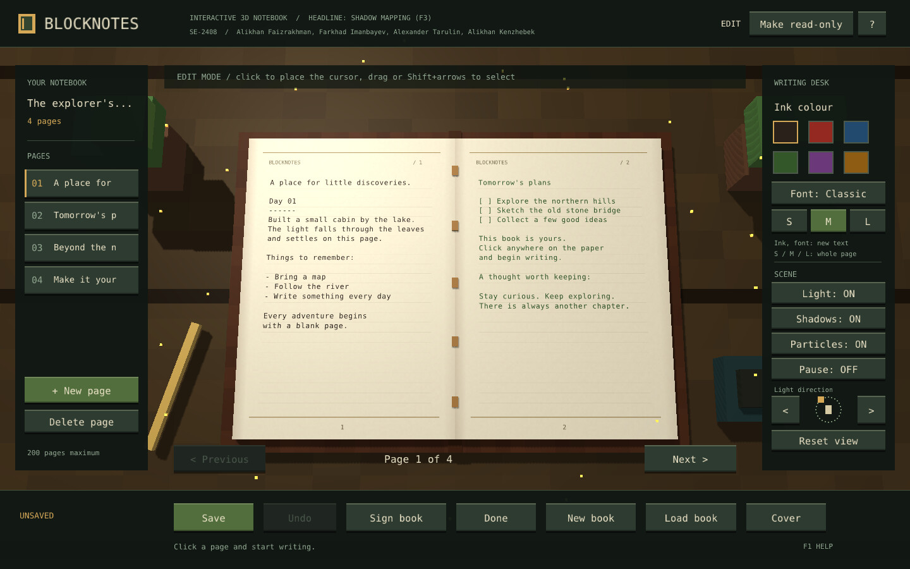
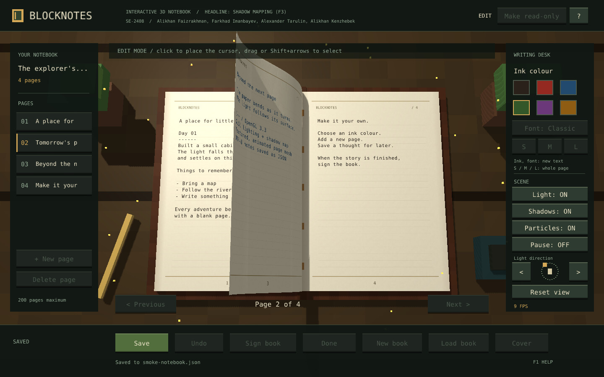
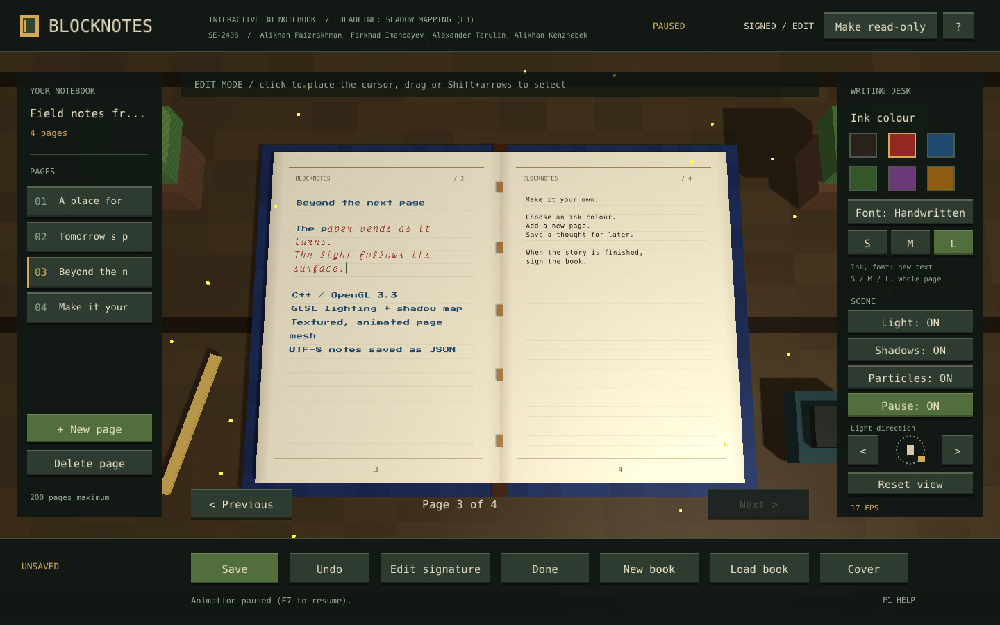
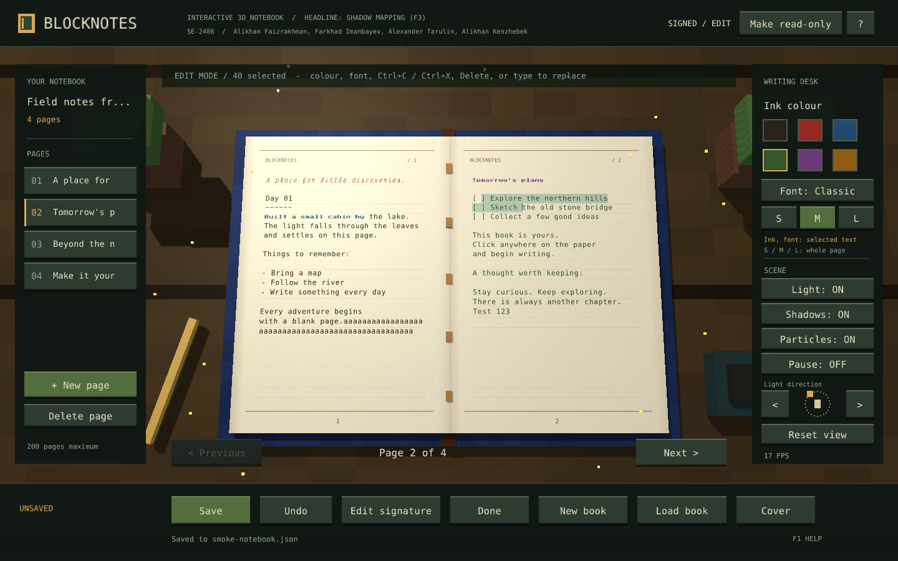
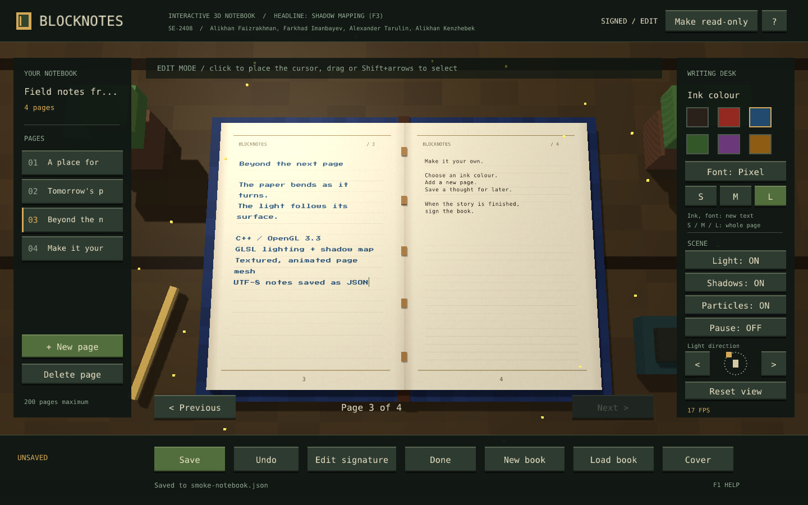
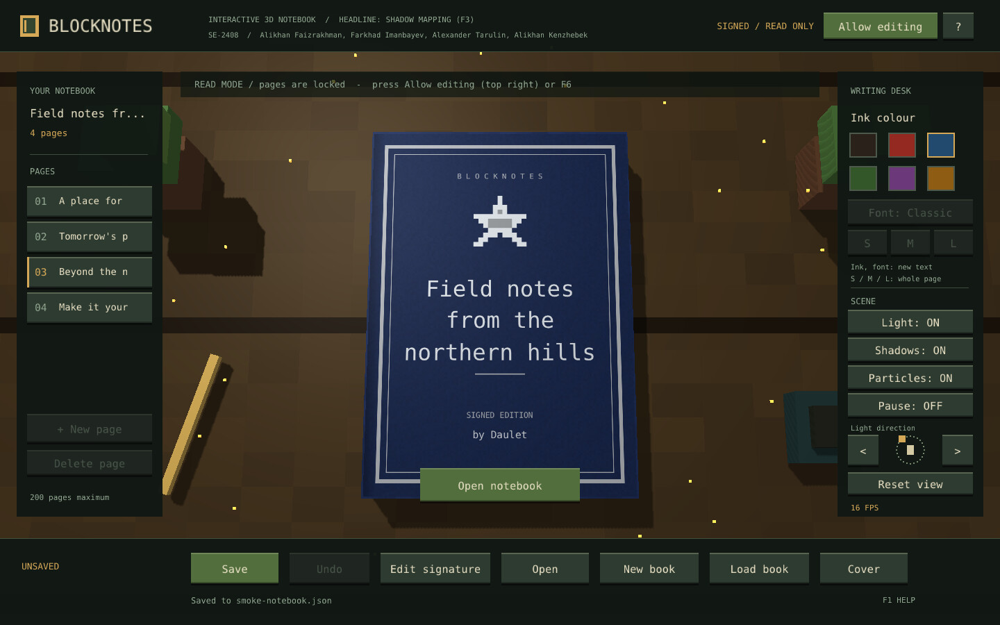
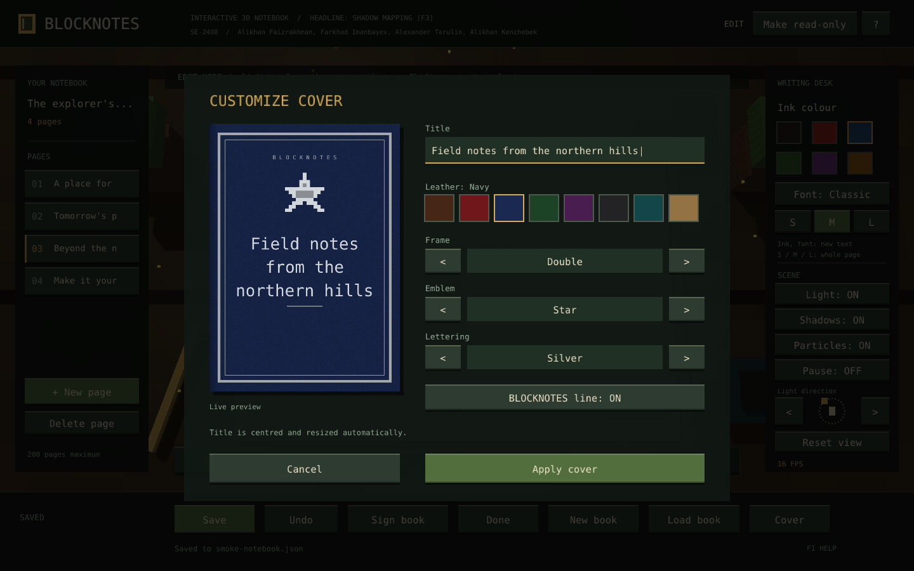
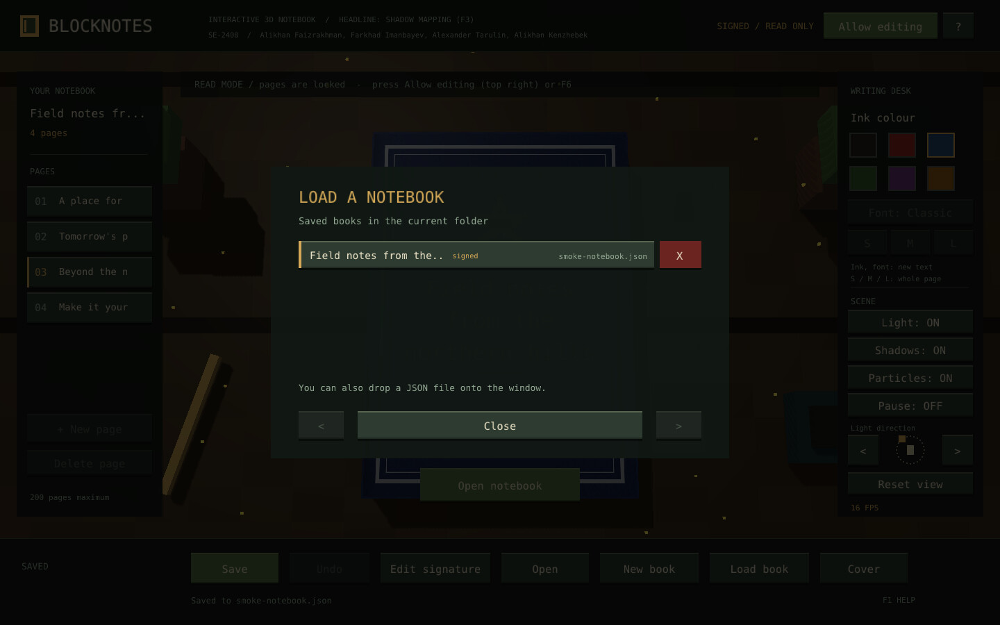

# BlockNotes

**An interactive 3D notebook rendered in real time with OpenGL 3.3 — headline technique: shadow mapping with PCF.**

BlockNotes is a desktop notebook inspired by the writable book in Minecraft. A blocky leather
notebook lies on a wooden desk; you can write on its pages, turn them with a curved 3D page-turn
animation, style the text, customise the cover and save every book as a JSON file. The whole
scene is lit by a movable light that casts real-time shadows.

Built with **C++17, OpenGL 3.3 Core Profile and GLSL**, using GLFW for the window and input.

---

## Screenshots

| | |
|---|---|
|  |  |
| **Open notebook** — two-page spread on the desk, lit by the movable light with real-time shadows | **Page turn** — the curved 3D sheet in the middle of the page-turn animation |
|  |  |
| **Movable light + pause** — light rotated to the right (see the compass), shadows follow; animation paused | **Text styling** — mixed ink colours and fonts on one page, with a text selection |
|  |  |
| **Fonts and sizes** — Pixel font at size L, Classic at size S | **Custom cover** — navy leather, double frame, star emblem, centred title |
|  |  |
| **Cover editor** with live preview | **Load book** — saved books with titles; the red X deletes a book |

*Screenshots were captured automatically on a machine without a GPU (software OpenGL), so the
FPS counter in them is lower than on real hardware.*

---

## Course information

| | |
|---|---|
| **University** | Astana IT University (AITU) |
| **Course** | Computer Graphics — Final Project, academic year 2026–2027 |
| **Instructor** | Sabina Saleshova |
| **Group** | SE-2408 |
| **Project title** | BlockNotes |
| **Headline technique** | Shadow mapping with percentage-closer filtering (PCF), toggled with **F3** |

## Team

| Member | Module | Responsibilities |
|---|---|---|
| **Alikhan Faizrakhman** | Camera, scene, mouse input, page text | Transformation matrices and orbit camera; scene composition, particles, light rotation and pause; mouse picking on the page, text selection and clipboard; glyph rendering and procedural page/cover textures |
| **Alikhan Kenzhebek** | Pages and book model | Page-curl mesh and smoothstep page-turn animation; hierarchical book model and desk props; word-wrap layout with S/M/L page grids and per-character styles; JSON book format with backups; unit tests |
| **Alexander Tarulin** | Renderer and shaders (headline) | Scene, depth and UI shaders; Blinn-Phong lighting; shadow mapping with a depth framebuffer and PCF filtering; back-face culling and wood/leather textures; signing, cover and load/delete dialogs |
| **Farkhad Imanbayev** | Window and interface | GLFW window, callbacks and keyboard input; typing, deleting and undo/redo; interface panels, buttons, Read/Edit mode and F1 help; autosave; CMake build, launch scripts and README |

All four members share responsibility for the headline technique and can explain the shadow-mapping shaders.

---

## Features

### Graphics
- **Shadow mapping (headline)** — the scene is first rendered from the light into a depth
  texture (framebuffer object); the main pass compares each fragment's light-space depth with
  that texture and softens the edge with PCF. **F3** turns it on and off.
- **Blinn-Phong lighting** with ambient, diffuse and specular terms (**F2** toggles lighting).
- **Movable light** — rotate it around the book with **Alt+Left / Alt+Right** or the arrows in the
  SCENE panel; a small compass shows where the light comes from.
- **3D page turn** — a procedurally curved sheet with an eased animation curve.
- **Particles** — floating dust/firefly particles (**F4** toggles them).
- **Pause** — **F7** freezes the animation clock (particles, page turn, caret) while editing keeps working.
- **Back-face culling** for solid geometry; two-sided paper sheets are drawn without culling so
  the back of a turning page stays visible.
- **Orbit camera** — right-drag to orbit, scroll to zoom; the projection adapts when the window is resized.

### Notebook
- Write on either page; the cursor follows the clicked position. Text wraps by words.
- Select text by dragging, Shift+click, Shift+arrows or Ctrl+A; copy, cut, paste, delete or type over it.
- **Ink colour** and **font** (Classic, Pixel, Handwritten) apply to the selected text or to the
  text you type next. **S / M / L** sets the text size of a page.
- Up to 200 pages, undo/redo, autosave 1.5 s after the last change, `.bak` backup of the last save.
- **Sign book** puts the title and "by Author" on the cover; **Read / Edit mode** (F6) locks or
  unlocks the pages.
- **Cover editor** — title, leather colour, frame, pixel emblem and lettering, with a live preview.
- **Load book** lists saved books; the red **X** deletes a book after confirmation.

---

## Controls

| Key / action | Effect |
|---|---|
| Click / drag on paper | Place the cursor / select text |
| Enter, Backspace, Delete | New line, erase before / after the cursor (or erase the selection) |
| Arrows, Home, End (+ Shift) | Move the cursor (+ extend the selection) |
| Ctrl+A / C / X / V | Select all / copy / cut / paste |
| Ctrl+Z / Ctrl+Y | Undo / redo |
| Ctrl+S / Ctrl+N | Save / add a page |
| Page Up / Page Down | Previous / next spread |
| Right-drag / mouse wheel | Orbit / zoom the camera |
| **F1** | Help |
| **F2 / F3 / F4** | Toggle lighting / **shadows (headline)** / particles |
| F5 | Reset camera and light |
| F6 | Switch Read / Edit mode |
| **F7** | Pause / resume animation |
| **Alt+Left / Alt+Right** | Rotate the light |
| Escape | Close a dialog or help, close / open the book |

---

## Build and run

**Tested platforms:** Windows 11 (64-bit) with Visual Studio 2022 (MSVC, CMake); Ubuntu Linux
with GCC. The prebuilt `windows/BlockNotes.exe` is built with MinGW-w64.
**Requirement:** a GPU driver with OpenGL 3.3 support.

### Option 1 — prebuilt executable (no compiler)
1. Extract the whole project (do not run it from inside the ZIP).
2. Double-click **`START_DEMO.bat`** (sample notebook) or **`START_BLOCKNOTES.bat`** (blank notebook).

### Option 2 — Visual Studio 2022
1. Install the **Desktop development with C++** workload (includes CMake).
2. *File → Open → Folder…* and choose the project folder.
3. Select the **x64-Release** configuration (from `CMakePresets.json`) and the
   **BlockNotes.exe** target, then press ▶. Debug builds are much slower.

### Option 3 — command line (CMake 3.16+)
```powershell
cmake -S . -B build
cmake --build build --config Release
ctest --test-dir build -C Release --output-on-failure
.\build\Release\BlockNotes.exe --demo
```
Or simply run **`BUILD_AND_RUN_WINDOWS.bat`**. All dependencies are included in `third_party/`;
nothing is downloaded during the build.

On Linux:
```sh
sudo apt install build-essential cmake libx11-dev libxrandr-dev libxinerama-dev libxcursor-dev libxi-dev libgl1-mesa-dev
cmake -S . -B build -DCMAKE_BUILD_TYPE=Release && cmake --build build -j
./build/BlockNotes --demo
```

### Where books are saved
| Platform | Folder |
|---|---|
| Windows | `%APPDATA%\BlockNotes\` |
| Linux | `~/.local/share/BlockNotes/` |
| macOS | `~/Library/Application Support/BlockNotes/` |

---

## Project structure

| Path | Contents |
|---|---|
| `src/` | C++ source: application and UI, document model, renderer, text rendering |
| `shaders/` | GLSL programs: scene (lighting + shadows), shadow depth pass, 2D interface |
| `tests/` | Unit tests for the document model (editing, layout, styles, JSON) |
| `assets/` | Fonts and their licences |
| `third_party/` | External libraries (see below) — **not written by the team** |
| `docs/` | Technical notes, demo script, credits, AI-use statement, screenshots |
| `windows/` | Prebuilt 64-bit Windows executable with its assets and shaders |

---

## Third-party libraries and assets

| Library / asset | Purpose | Licence |
|---|---|---|
| [GLFW](https://www.glfw.org/) | Window, OpenGL context, input | zlib/libpng |
| [GLAD](https://github.com/Dav1dde/glad) | OpenGL function loader | MIT / public domain |
| [GLM](https://github.com/g-truc/glm) | Vector and matrix math | MIT |
| [nlohmann/json](https://github.com/nlohmann/json) | JSON save / load | MIT |
| [stb_truetype](https://github.com/nothings/stb) | Font rasterisation | MIT / public domain |
| DejaVu Sans Mono | Interface and "Classic" page font | Bitstream Vera / DejaVu licence |
| Press Start 2P | "Pixel" page font | SIL Open Font License 1.1 |
| Victor Mono Italic | "Handwritten" page font | SIL Open Font License 1.1 |

All textures (wood, leather, paper, cover) are generated procedurally by the program.
Full licence texts are in `third_party/` and `assets/`; sources are listed in `docs/CREDITS.md`.

## Use of AI tools

Parts of the implementation were produced with AI assistance (OpenAI ChatGPT/Codex and
Anthropic Claude). Every module was reviewed, tested and integrated by its owner listed in the
Team table. Details of what was generated are given in `docs/AI_USE.md`, as required by the
course's academic-integrity rules.

## Known limitations

- Pages use a fixed character grid (monospaced fonts), so one page has one text size.
- The page turn is a geometric animation, not a cloth simulation.
- Only one running instance should edit a given notebook file at a time.
